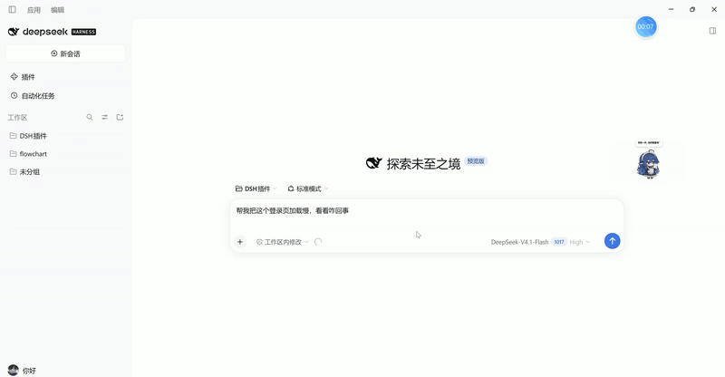
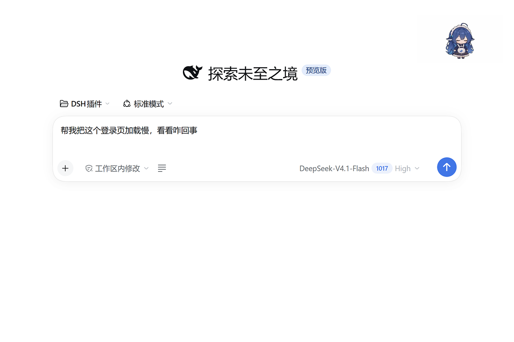
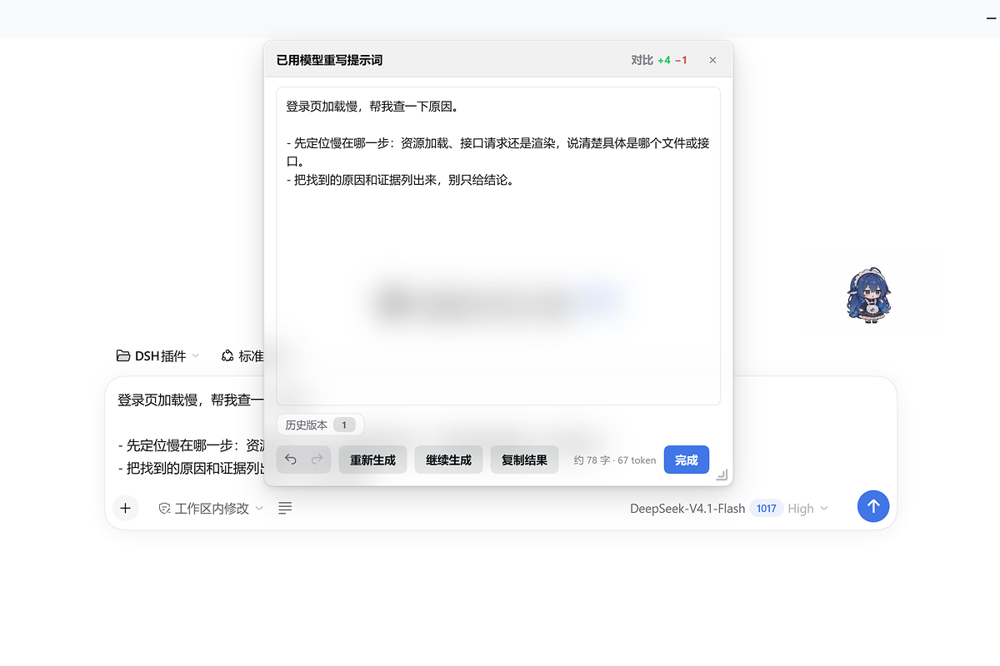
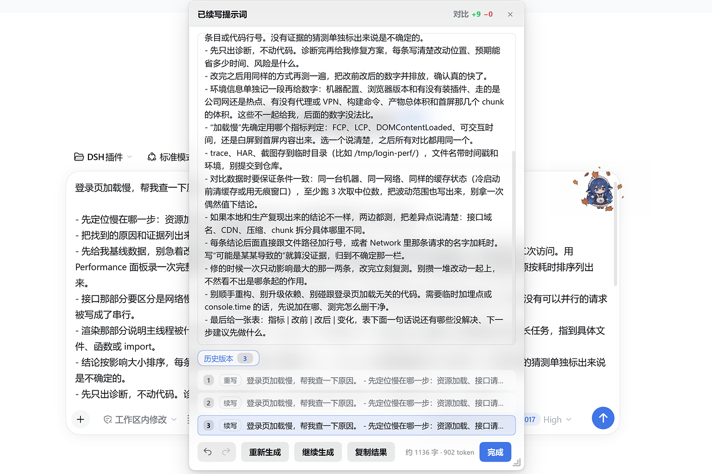
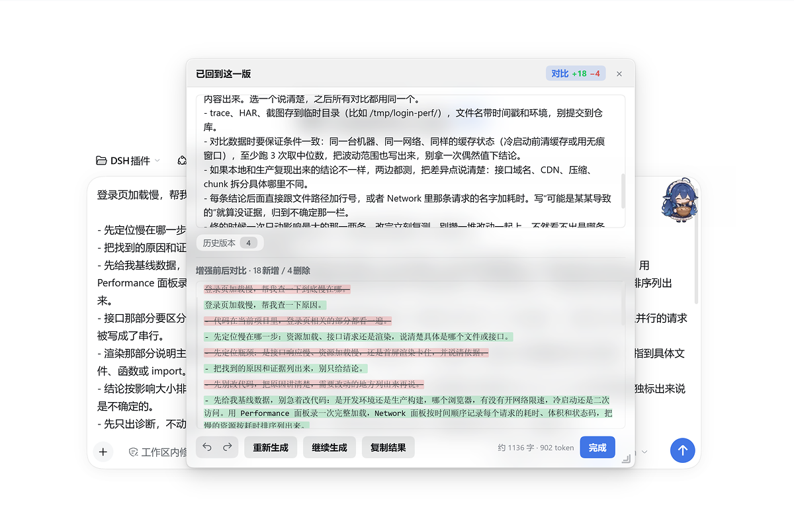
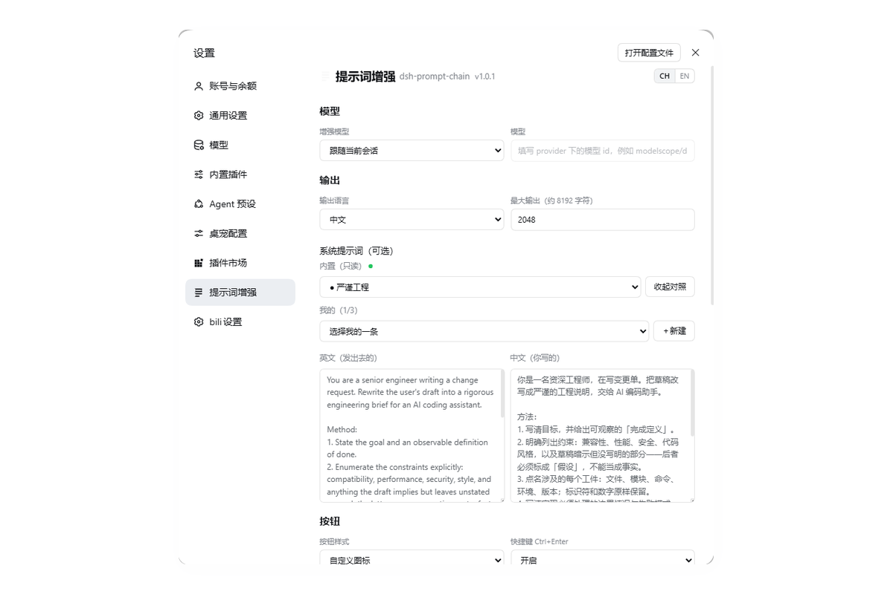
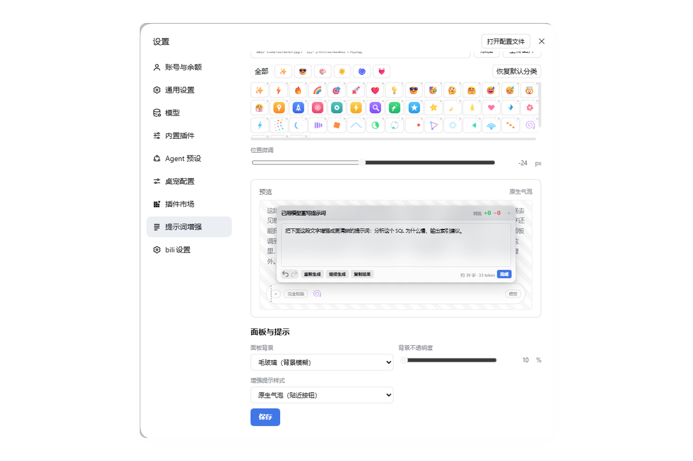

<div align="center">


# dsh-prompt-chain

**在 DSH 输入框里按一下增强按钮，把随手写的草稿变成结构清晰、能直接执行的提示词——写长了还能一轮一轮接着说下去。**

[](https://github.com/Nihao7-L/dsh-prompt-chain/releases)
[](./LICENSE)
[](#兼容性与限制)
[](#兼容性与限制)

[English](./README.en.md) · **简体中文**

</div>



<sub>18 秒看完：随手写一句 → 点增强按钮 → 继续生成 → 逐行对比 → 换图标。</sub>

---

## 界面速览

| 1 | 2 |
| --- | --- |
|  |  |
| **点输入框左边的按钮**——默认是圆形图标，可换成 emoji、图片或动图 | **结果实时写回输入框**，底栏有重新生成 / 继续生成 / 复制 / 完成 |
|  |  |
| **接着往下写**，最多 5 轮，每轮都进历史，点任意一版回跳 | **绿色是新增、红色是删除**，顶栏直接给「N 处改动」 |
|  |  |
| **6 个内置方案只读**，自建的最多 3 条；左英右中，英文那份才是发出去的 | **2 组静态 + 1 组手绘 + 3 组动图**，都能换成按钮图标 |

---

## 功能一览

| 能力 | 说明 |
| --- | --- |
| 一键增强 | 读输入框草稿 → 模型改写 → 结果面板；面板里的内容实时写回输入框，不用再点「回填」 |
| 继续生成 | 在改写结果上继续往下写，最多 5 轮，底栏显示「还可续写 n 次」；到上限会提示改用「重新生成」 |
| 重新生成 | 丢掉面板里改过的内容，用**最初那版草稿**重新改一次 |
| 历史版本 | 每一版结果都留在计数胶囊里，点任意一版回跳；撤销/重做一路到底 |
| 逐行对比 | 「对比」把改写前后逐行标出新增/删除/未变，并给出「N 处改动」 |
| 提示词方案 | 6 个内置模板只读；自建最多 3 条，可新建 / 改名 / 删除；中英双栏对照，可一键免费翻译 |
| 自定义系统提示词 | 直接编辑真正发给模型的系统提示词；「只输出改写后的提示词、不要解释」这条硬契约永远由插件追加，改不坏 |
| 模型选择 | 默认跟随当前会话模型；也可以固定某个 provider + 模型，或临时指定（下拉选择或手填 id） |
| 按钮外观 | 三种样式（圆形 / 文字 / 表情），图标库 6 组内置（2 组静态 emoji + 1 组手绘图片 + 3 组动图）＋ 自己的表情包；动图 gif 保留动画（≤128KB），内置单个表情可隐藏 |
| 面板外观 | 玻璃质感 / 纯色、不透明度滑杆（可精确输入）、相对输入框的位置微调（±240px） |
| 快捷键 | Ctrl+Enter 增强，可关 |
| 界面语言 | 设置页头部 `CH / EN` 一键切换整个插件界面（自动 / 中文 / 英文） |
| 失败可读 | 出错时面板显示完整错误原文并可一键复制；空输入、超长、中断、断链都有明确说明 |

---

## 安装

> 前提：DSH 0.2.x（桌面端或 Web 端均可）。

**方式 1 · 插件市场**（发布后可用）
插件市场里搜索 `dsh-prompt-chain`（或「提示词链」）→ 安装 → 完全退出 DSH 再打开。

**方式 2 · 命令行**
```bash
dsh plugin add dsh-prompt-chain
```
装完 **完全退出 DSH 再打开**。（需要这个包已经发布到 npm；发布前请用下面的方式 3。）

**方式 3 · 下载 tgz 安装**（发布前唯一可用）
在 [Releases](https://github.com/Nihao7-L/dsh-prompt-chain/releases/latest) 下载 `dsh-prompt-chain.tgz`，然后：
```bash
dsh plugin add .\dsh-prompt-chain.tgz
```
或者打开 DSH 的插件页 →「从本地安装」→ 选这个 tgz。

**方式 4 · 从源码目录安装**（本地开发时）
```powershell
cd C:\Users\<你>\.dsh\profiles\desktop
pnpm add "dsh-prompt-chain=file:D:/你的路径/dsh-prompt-chain"
```
然后把 `dsh-prompt-chain` 加进同目录 `package.json` 的 `dsh.profile.bundles` 数组，重启 DSH。

装好后在 **设置 → 提示词增强** 里能看见这一节，就说明宿主半边和界面半边都加载了。

> 这个插件有两半：界面半边（`client.js`）随页面刷新生效，宿主半边（`index.js`，负责调用模型和读写配置）**必须完全退出 DSH 再打开**。升级后如果提示「插件宿主没加载（接口返回 404）」，就是只刷新了页面、没重启。

---

## 使用场景

**① 一句话变成能派活的工单**
> 草稿：`首页加载太慢，帮我看看`
> 改写后：目标（首页 LCP 降到 2.5s 内）、现状（组件树 / 接口调用、可测量的入口）、要求（只改 `src/pages/home`，不许动全局样式）、验收（Lighthouse 分数 / 网络面板截图）分块列出，模型可以直接开工。

**② 长文续写（本插件独有的用法）**
一次改写出的方案往往只覆盖前半段。点「继续生成」，模型在已有内容的基础上补测试计划、回滚步骤、灰度策略；每轮都进历史，哪一轮写歪了就点回去重来。

**③ 把「严谨工程」当成团队规范**
设置里选「严谨工程」方案，之后每次增强都会带上边界条件、错误处理、可验证标准——不用每次手写这一长串要求。

**④ 教学 / 讲解**
选「讲解思路」，改写出的提示词会要求模型先讲思路再给代码，适合学习新东西时用。

---

## 常见问题

**按钮没出现？**
确认插件已启用、且为「立即加载」；然后刷新页面（`Ctrl+R`）。仍然没有就完全重启 DSH。

**点增强按钮提示「插件宿主没加载（接口返回 404）」？**
宿主半边没起来。完全退出 DSH（不是关窗口）再打开。注意：宿主没起来时设置**存不进去**，页面上改的东西关掉就没了。

**增强出来的是英文 / 中文？**
输出语言跟随草稿（`auto`）。想固定就在设置里改。

**「继续生成」为什么只能 5 次？**
文本越长模型越难顺下去，接出来的质量会掉。到上限后建议「重新生成」或手动改。

**翻译按钮一直转圈？**
翻译走的是免费公共接口（MyMemory，备用 LibreTranslate 镜像），需要能访问外网；失败时不会消耗你的模型额度。

**我改坏了设置怎么办？**
删掉 `~/.dsh/prompt-chain/config.json` 重启即可回到默认。提示词、图标都在这个文件里，先备份。

---

## 兼容性与限制

- 平台：DSH 桌面端 / Web 端（`platform: web`），Linux / macOS 上的 DSH 同样可用。
- `engines.dsh`：`^0.1.2-rc.1 || ^0.1.7-rc.2 || ^0.2.0-rc.1`（当前在 0.2.1-rc.2 上验证）。
- 增强/继续走 DSH 自己的模型通道（默认跟随会话），所以用的是你已配置的 provider；不需要额外填 API key。
- 免费翻译依赖第三方公共接口，可能限流或不可用——不可用时英文栏会留空，不影响增强。
- 自建提示词上限 3 条、图片图标单张 ≤2MB、gif ≤128KB（超限自动退回静帧预览）；内置表情库共 6 组：2 组静态 emoji、1 组手绘图片、3 组动图，内置单个表情也可隐藏。
---

## 隐私

- 配置只写在本机 `~/.dsh/prompt-chain/config.json`。
- 增强/继续的请求发给你在 DSH 里配置的模型服务（跟你在会话里说话走同一条通道）。
- 上传的图标以 data URI 存在本机配置里，不上传任何图床。
- 只有点「翻译」时，被翻译的那段文本会发给免费翻译接口。

---

## 开发

```
dsh-prompt-chain/
├── index.js           # 宿主半边：路由 / 模型调用 / 配置读写 / 翻译
├── client.js          # 界面半边：输入框按钮、结果面板、设置页（单文件 bundle）
├── src/config.js      # 两端共用的默认值、归一化与提示词拼装
├── cordis.patch.yml   # dsh.bundle.patch：把自己插进插件树
├── docs/              # README 用的截图与演示动图（不进 npm 包）
├── icon.svg
└── CHANGELOG.md       # 更新记录
```

改完 `client.js` 后 `node --check client.js` 先过语法，再刷新页面看效果；改 `index.js` / `src/config.js` 必须重启。

## 许可

[MIT](./LICENSE) © 2026 Nihao7-L
